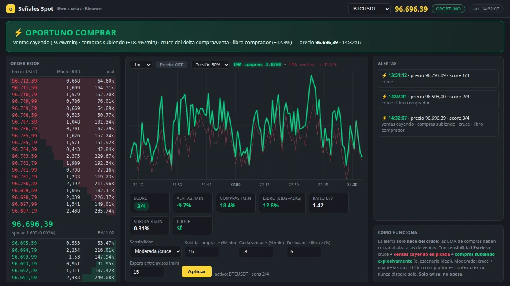

# USDT Señales

> Un tablero que mide presión compradora y vendedora con volumen taker, EMA y pendiente, y avisa cuando las dos se cruzan. No opera.



**Software & IA · datos de mercado** · **120** velas · **4** señales · **15 min** enfriamiento · **0** órdenes

## Qué es

USDT Señales: Flask + Binance Spot para detectar cruces de volumen taker, puntuar la señal y mostrar el libro como contexto. Solo avisa.

El proyecto no envía órdenes ni custodía fondos. Las decisiones y el riesgo son del operador.

## El problema

### El precio solo no cuenta toda la historia.

Dos velas pueden cerrar en el mismo precio y, aun así, una tener compradores agresivos y la otra vendedores agresivos.

- El volumen taker distingue quién cruzó el spread: si dominan las compras agresivas o las ventas agresivas. Esa presión aparece antes que el cambio de precio y se puede medir.
- USDT Señales combina ese volumen con una EMA corta y una pendiente normalizada por minuto. El resultado es un score de 0 a 4 y una alerta cuando el cruce supera el umbral de sensibilidad.
- No es un bot ni una recomendación financiera. Es un tablero de observación: avisa, muestra el contexto del libro y espera 15 minutos antes de repetir la misma señal.

## Cómo funciona

### Cuatro números y una señal.

Cada muestra se convierte en presión, tendencia y contexto; el score decide si vale la pena mirar.

1. **Muestrear** — Un hilo consulta velas, ticker y libro de Binance Spot cada pocos segundos.
2. **Separar taker** — Calcula volumen comprador y vendedor agresivo y su proporción sobre el total.
3. **Medir tendencia** — EMA 5 y EMA 20 sobre el precio; la pendiente se normaliza en % por minuto.
4. **Puntuar** — El score suma presión, cruce de EMAs, pendiente y libro. La sensibilidad ajusta el umbral.
5. **Alertar** — Si el score alcanza el umbral y pasó el enfriamiento, se emite la alerta y se registra.

## Arquitectura

### Un sampler, una API, un tablero.

El backend mantiene el estado en memoria; la interfaz consulta y dibuja sin bloquear.

`Binance` (API pública) → `Sampler` (hilo Python) → `Flask` (/api/state) → `Tablero` (JS + libro)

- **Sin credenciales**: Solo endpoints públicos. No hay API key ni firma.
- **Tres sensibilidades**: Relajada, moderada y estricta cambian el umbral del score.
- **Enfriamiento**: 15 minutos para evitar alertas repetidas por la misma condición.

## Capturas


*Tablero: precio, señal, order book, alertas y panel de sensibilidad.*

## Stack

Python, Flask, Binance Spot, JavaScript, WebSocket.

Flask sirve la página y el estado; un hilo de muestreo mantiene las métricas. La interfaz usa JavaScript y WebSocket para el libro. No hay base de datos: el estado vive en memoria y se reinicia con el proceso.

## Instalación rápida

```bash
python3 -m venv .venv
source .venv/bin/activate
pip install -r requirements.txt
python3 app.py
# Abrir http://127.0.0.1:8790
```

## Estructura del repositorio

```text
usdt-senales/
├── app.py               # Flask + hilo de muestreo
├── templates/index.html # tablero en vivo
├── requirements.txt
├── run.sh
├── docs/                # página, datasheet y developer
└── README.md
```

## Límites y decisiones

- **No opera**: No hay órdenes, claves ni custodia. Es un tablero de observación.
- **Datos públicos**: Binance puede limitar tasa o cambiar endpoints; el sampler debe adaptarse.
- **Sin persistencia**: El estado se pierde al reiniciar. No hay histórico ni base de datos.
- **Riesgo**: Una señal técnica no garantiza rentabilidad. No es asesoría financiera.

## Preguntas frecuentes

**¿Necesito una cuenta de Binance?**

No. Se usan endpoints públicos de Spot.

**¿Abre operaciones?**

No. Solo muestra y avisa; la ejecución es manual y externa.

**¿Cada cuánto avisa?**

Respeta un enfriamiento de 15 minutos para la misma condición.

**¿Qué significa el score?**

Un puntaje de 0 a 4 que combina presión taker, EMAs, pendiente y libro.


## Seguridad

No usa API keys: lee datos públicos de Binance Spot. No opera, no firma y no custodia fondos. Las señales son experimentales y no constituyen asesoría financiera.


## Documentación

- [Datasheet](docs/datasheet.md): qué hace, cómo se usa y qué límites tiene.
- [Developer](docs/developer.md): arquitectura, archivos y puntos de extensión.
- [Página del proyecto](https://jmadasme.github.io/usdt-senales/): capturas, video y guía visual.

## Seguridad y datos

No usa API keys: lee datos públicos de Binance Spot. No opera, no firma y no custodia fondos. Las señales son experimentales y no constituyen asesoría financiera.

Las claves, tokens y contraseñas de ejemplo se publican como `x`. Si vas a desplegar el proyecto, creá tus propios secretos y no los subas al repositorio.

## Licencia

MIT © jmadasme. El código se comparte para estudio y reutilización; los datos de terceros conservan sus propias licencias.
