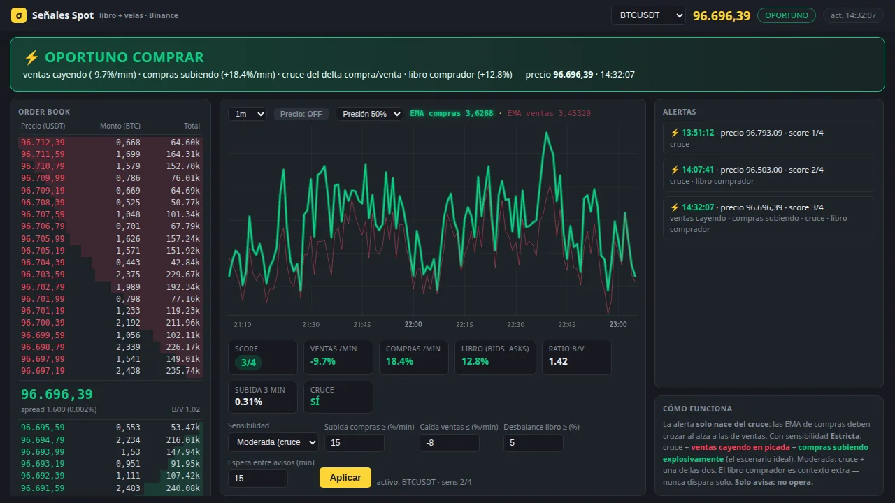

# USDT Señales · datasheet

**Software & IA · datos de mercado**

USDT Señales — Un tablero que mide presión compradora y vendedora con volumen taker, EMA y pendiente, y avisa cuando las dos se cruzan. No opera.

## Ficha

| Métrica | Valor |
|---|---|
| 120 | velas |
| 4 | señales |
| 15 min | enfriamiento |
| 0 | órdenes |

## Qué resuelve

Dos velas pueden cerrar en el mismo precio y, aun así, una tener compradores agresivos y la otra vendedores agresivos.

## Cómo se opera

1. **Muestreo** — El hilo consulta velas y libro de Binance cada pocos segundos.
2. **Cruce** — Compara EMA de volumen taker comprador contra vendedor y calcula la pendiente.
3. **Score** — Suma razones de compra/venta y las clasifica en 0–4.
4. **Alerta** — Si el score supera la sensibilidad elegida, muestra un aviso y espera el enfriamiento.

## Flujo técnico

| Etapa | Qué ocurre |
|---|---|
| Muestrear | Un hilo consulta velas, ticker y libro de Binance Spot cada pocos segundos. |
| Separar taker | Calcula volumen comprador y vendedor agresivo y su proporción sobre el total. |
| Medir tendencia | EMA 5 y EMA 20 sobre el precio; la pendiente se normaliza en % por minuto. |
| Puntuar | El score suma presión, cruce de EMAs, pendiente y libro. La sensibilidad ajusta el umbral. |
| Alertar | Si el score alcanza el umbral y pasó el enfriamiento, se emite la alerta y se registra. |

## Capturas

*Tablero: precio, señal, order book, alertas y panel de sensibilidad.*

## Límites

| Límite | Detalle |
|---|---|
| No opera | No hay órdenes, claves ni custodia. Es un tablero de observación. |
| Datos públicos | Binance puede limitar tasa o cambiar endpoints; el sampler debe adaptarse. |
| Sin persistencia | El estado se pierde al reiniciar. No hay histórico ni base de datos. |
| Riesgo | Una señal técnica no garantiza rentabilidad. No es asesoría financiera. |

## Preguntas frecuentes

**¿Necesito una cuenta de Binance?**

No. Se usan endpoints públicos de Spot.

**¿Abre operaciones?**

No. Solo muestra y avisa; la ejecución es manual y externa.

**¿Cada cuánto avisa?**

Respeta un enfriamiento de 15 minutos para la misma condición.

**¿Qué significa el score?**

Un puntaje de 0 a 4 que combina presión taker, EMAs, pendiente y libro.

## Seguridad

No usa API keys: lee datos públicos de Binance Spot. No opera, no firma y no custodia fondos. Las señales son experimentales y no constituyen asesoría financiera.

## Enlaces

- [README](../README.md)
- [Developer](developer.md)
- [Página del proyecto](https://jmadasme.github.io/usdt-senales/)
